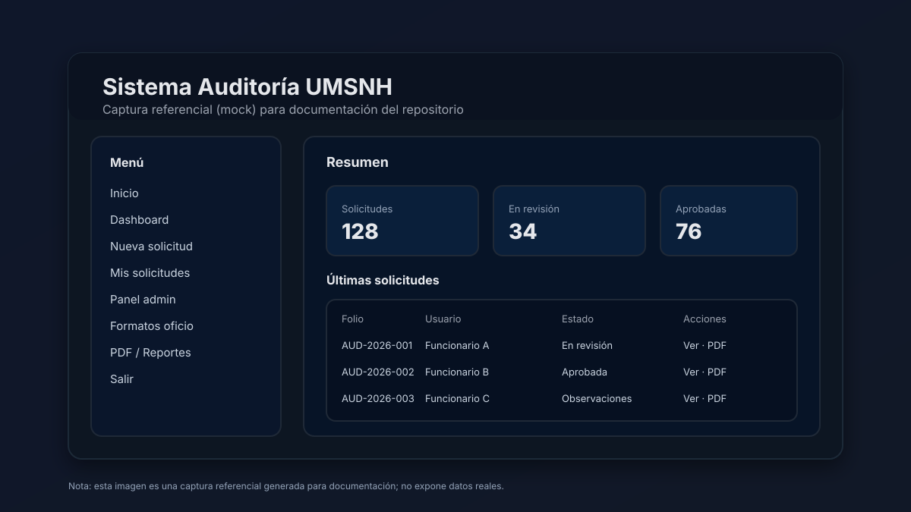

# Sistema Auditoría UMSNH

Sistema web en **Django** para gestionar el flujo de **solicitud, revisión y seguimiento** de auditorías (entrega–recepción) dentro de la Universidad Michoacana de San Nicolás de Hidalgo (UMSNH).

> Este repositorio contiene el código fuente del sistema, plantillas HTML, estilos y configuración del proyecto.

## Captura



## Objetivo del sistema

- Permitir que **funcionarios** registren una **solicitud de auditoría** mediante un formulario.
- Facilitar al **área administrativa** (usuarios con permisos de staff/superuser) la **revisión**, **observaciones**, **cambio de estado** y **generación de PDF** (oficio / documento) asociado.
- Centralizar el histórico de solicitudes, evidencias y documentos generados.

## Roles y permisos

- **Funcionario (usuario normal)**
  - Crea solicitudes.
  - Consulta el estatus y detalle de sus solicitudes.
  - Descarga PDF (si aplica) según el flujo definido por el sistema.

- **Administrador (is_staff / is_superuser)**
  - Accede a panel administrativo dedicado (rutas bajo `/panel/`).
  - Revisa solicitudes, agrega observaciones y actualiza estados.
  - Administra formatos/plantillas para la generación del oficio.

## Módulos (apps) principales

- `config/`: configuración global del proyecto (settings/urls/wsgi/asgi).
- `core/`: home, autenticación, dashboard general.
- `solicitudes/`: modelo y flujo principal de **SolicitudAuditoria** (formularios y vistas para usuarios).
- `admin_panel/`: panel para administración, catálogo de formatos y generación/edición de PDF.

## Modelos (referencia)

- `SolicitudAuditoria`
  - Datos del solicitante/unidad responsable.
  - Periodo del encargo.
  - Solicitud especial y archivos de respaldo (p. ej. nombramiento).
  - Estado/observaciones administrativas.

- `FormatoOficio`
  - Plantilla HTML (editable) usada para generar el documento/oficio.
  - Bandera de activo.

> Nota: Para detalles exactos, revisar los modelos en el código fuente.

## Rutas principales (alto nivel)

- Público/usuario:
  - `/` (home)
  - `/login/`, `/registro/`, `/dashboard/`
  - `/solicitudes/nueva/`, `/solicitudes/mis/`, `/solicitudes/<pk>/`, `/solicitudes/<pk>/pdf/`

- Administración:
  - `/panel/`
  - `/panel/solicitudes/`, `/panel/solicitudes/<pk>/`, `/panel/solicitudes/<pk>/editar/`, `/panel/solicitudes/<pk>/pdf/`
  - `/panel/formatos/`, `/panel/formatos/nuevo/`, `/panel/formatos/<pk>/editar/`

## Tecnologías

- Python 3.9 (referencia)
- Django 4.2.x
- SQLite para desarrollo local
- `fpdf2` para generación de PDF
- `Pillow` para manejo de imágenes

## Requisitos

- Python 3.x

## Instalación (desarrollo)

```bash
python -m venv .venv
# En Windows PowerShell:
#   .venv\Scripts\Activate.ps1
pip install -r requirements.txt
python manage.py migrate
python manage.py runserver
```

## Archivos importantes

- `requirements.txt`: dependencias.
- `manage.py`: entrypoint de Django.
- `CONTEXT.md`: resumen técnico/funcional del proyecto.

## Notas

- `db.sqlite3` se ignora en Git para evitar conflictos entre entornos.
- `media/` se ignora porque contiene archivos subidos por usuarios (evidencias/nombramientos).
